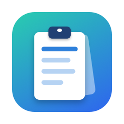

<p align="center"></p>

<h1 align="center">Keepy</h1>

<p align="center">A macOS menu bar clipboard history that keeps what you copy so you can paste it again<br>Open it with one shortcut, type to find, and paste with a single Return.</p>

<p align="center">
  <a href="https://github.com/eddieee-git/mac-app-keepy/releases/latest">Download the latest version</a> ·
  <a href="#install">Install</a> ·
  <a href="#how-to-use">How to use</a> ·
  <a href="#shortcuts">Shortcuts</a> ·
  <a href="#faq">FAQ</a> ·
  <a href="CHANGELOG.en.md">Changelog</a> ·
  <a href="README.md">한국어</a>
</p>

## Features

- **Records everything**: Text (with formatting), images and files copied in Finder. Copy the same thing again and it moves back to the top.
- **Quick history window**: Opens over the app you're using with a shortcut, and you find items as you type. It doesn't take focus from that app.
- **Paste right away**: Pick an item and it's pasted into the app you were using. Hold ⌥ to paste as plain text.
- **Pin**: Pin items you use often to the top. Pinned items don't count toward the limit and survive clearing the history.
- **Privacy**: Copies that password managers mark as concealed, and copies from apps you exclude, are never recorded. You can also pause recording from the menu bar.
- **Stays on this Mac**: The history is stored only on this Mac and never sent anywhere.
- **In-app updates**: Tells you about new versions, checks the signature and swaps the app in place.
- **Korean and English**: Follows your Mac's language at first; change it in Settings.

## Install

Requires an Apple silicon Mac with macOS 14 or later.

1. Download `Keepy-x.y.z.dmg` from [Releases](https://github.com/eddieee-git/mac-app-keepy/releases/latest) and open it.
2. Drag **Keepy** into the **Applications** folder.
3. Open Keepy. It isn't signed by an Apple developer, so macOS refuses to open it the first time. Click **Done**, then:
   - **macOS 15 (Sequoia) or later**: Scroll to the bottom of System Settings → Privacy & Security, click **Open Anyway** next to Keepy, then **Open**.
   - **macOS 14 (Sonoma)**: Right-click Keepy in Applications → **Open**.

   If you prefer Terminal, run `xattr -dr com.apple.quarantine /Applications/Keepy.app`.
4. **Getting Started** opens on first launch. Click **Allow** next to **Accessibility** and turn Keepy on in the list. It's needed to paste the item you pick right away (without it, Keepy still copies it to the clipboard).

## How to use

1. Copy as usual. Keepy keeps a record from the menu bar.
2. Where you want to paste, press **⌃⌥V**, or click the Keepy icon in the menu bar → **Open Clipboard History**.
3. Type to search, choose with **↑↓** and press **Return** to paste it there. You can also pick directly with **⌘1–9**.
4. Pin items you use often with **⌘P**. The menu bar menu also lists the 10 most recent items to paste.

Opening Keepy directly from Applications or Spotlight also shows the history window. Picking an item there just copies it and returns you to the app you were using, so paste it with ⌘V wherever you like.

Other tools (such as Shortcuts) can open the history window with `open keepy://show`.

## Shortcuts

| Key | Action |
|---|---|
| ⌃⌥V | (Global) Open clipboard history |
| ↑ ↓ | Choose an item |
| Return | Paste |
| ⌥Return | Paste as plain text |
| ⌘1–9 | Paste that item right away |
| ⌘P | Pin / Unpin |
| ⌘⌫ | Delete |
| ⌘Z | Undo delete |
| esc | Clear search / Close |

You can change or turn off the global shortcut in Settings → **Shortcuts**.

## Settings

| Item | Description |
|---|---|
| Items to keep | 50 / 100 / 200 / 500 / 1000. Pinned items aren't counted (default 200) |
| History window position | At the pointer / Center of the screen (default at the pointer) |
| Paste right after picking | When off, Keepy only copies to the clipboard (default on) |
| Excluded apps | Copies from these apps aren't recorded. Keychain Access, Passwords, 1Password and Bitwarden are included by default |
| Open at login | Start Keepy when your Mac starts |
| Language | System / 한국어 / English |
| Check for new versions automatically | Checks GitHub for a new version once a day (default on) |
| Install new versions automatically | Installs a found version when you're not using the app, then reopens it (default on) |

## FAQ

**What information does Keepy send?**
Only one request to the public GitHub API asking for the latest release, when checking for updates. What you copy is never sent anywhere. Turn off automatic checks in Settings and nothing is sent at all.

**Where is the history stored?**
In `~/Library/Application Support/Keepy/` (`history.json` and a `blobs` folder with images and formatting). Open it from Settings → General → **Show in Finder**.

**Does it record passwords?**
Password managers mark what they copy as concealed (`org.nspasteboard.ConcealedType`), and Keepy never records those copies. For apps that don't, add them in Settings → **Excluded Apps**.

**Picking an item only copies it instead of pasting.**
That happens when Accessibility permission is off. Turn on Keepy in System Settings → Privacy & Security → Accessibility. If it stops working after an update, turn it off and on again.

## Uninstall

1. Keepy icon in the menu bar → **Quit Keepy**
2. Move Keepy from Applications to the Trash
3. (Optional) To remove the history, delete `~/Library/Application Support/Keepy`; to remove settings, run `defaults delete com.eddieee.Keepy`

## Build from source

Requires an Apple silicon Mac with macOS 14 or later and the Xcode Command Line Tools (Xcode itself isn't needed).

```bash
./scripts/test.sh        # self-test
./scripts/build-app.sh   # build/Keepy.app + build/Keepy-<version>.dmg
open build/Keepy.app
```

## License

[MIT](LICENSE)

<!-- more-apps:start -->
## More apps

| | App | |
|---|---|---|
|  | [Clocky](https://github.com/eddieee-git/mac-app-clocky) | Flip-clock timers, alarms and calendar alerts from the menu bar |
|  | [Floaty](https://github.com/eddieee-git/mac-app-floaty) | Floating sticky notes, right from the menu bar |
|  | [Gitty](https://github.com/eddieee-git/mac-app-gitty) | Work with Git repositories like a file manager |
|  | [Grabby](https://github.com/eddieee-git/mac-app-grabby) | Capture, mark it up in place, and paste right away |
|  | [Peeky](https://github.com/eddieee-git/mac-app-peeky) | Bring back menu bar icons hidden behind the notch |
<!-- more-apps:end -->
