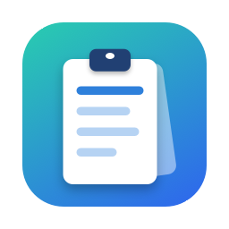

<p align="center"></p>

<h1 align="center">Keepy</h1>

<p align="center">복사한 내용을 모아 두었다가 다시 붙여 넣는 macOS 메뉴바 클립보드 기록 앱<br>단축키 하나로 열고, 입력해서 찾고, ↩ 한 번으로 붙여 넣어요.</p>

<p align="center">
  <a href="https://github.com/eddieee-git/mac-app-keepy/releases/latest">최신 버전 내려받기</a> ·
  <a href="#설치">설치</a> ·
  <a href="#쓰는-방법">쓰는 방법</a> ·
  <a href="#단축키">단축키</a> ·
  <a href="#자주-묻는-질문">자주 묻는 질문</a> ·
  <a href="CHANGELOG.md">변경 기록</a> ·
  <a href="README.en.md">English</a>
</p>

## 특징

- **모두 기록**: 텍스트(서식 포함), 이미지, Finder에서 복사한 파일을 기록해요. 같은 내용을 다시 복사하면 맨 위로 올라와요.
- **빠른 기록 창**: 단축키로 지금 쓰는 앱 위에 열고, 입력하면 바로 찾아요. 앞에 있던 앱에서 포커스를 빼앗지 않아요.
- **바로 붙여 넣기**: 고르면 앞에 있던 앱에 바로 붙여 넣어요. ⌥를 누르면 서식 없이 붙여 넣어요.
- **고정**: 자주 쓰는 항목은 맨 위에 고정해요. 고정한 항목은 개수 제한과 기록 지우기에서 빠져요.
- **개인정보 보호**: 비밀번호 관리자가 숨김 표시를 붙여 복사한 내용과 제외한 앱에서 복사한 내용은 기록하지 않아요. 메뉴바에서 기록을 잠시 멈출 수도 있어요.
- **이 Mac에만 저장**: 기록은 이 Mac에만 저장하고 어디에도 보내지 않아요.
- **앱 안 업데이트**: 새 버전이 나오면 알려 주고, 서명을 확인한 뒤 바꿔 넣어요.
- **한국어·영어**: 처음에는 Mac의 언어를 따르고, 설정에서 바꿀 수 있어요.

## 설치

Apple 실리콘 Mac, macOS 14 이상이 필요해요.

1. [Releases](https://github.com/eddieee-git/mac-app-keepy/releases/latest)에서 `Keepy-x.y.z.dmg`를 내려받아 열어요.
2. **Keepy**를 **Applications** 폴더로 끌어다 놓아요.
3. Keepy를 열어요. Apple 개발자 서명이 없는 앱이라 처음 한 번은 열 수 없다는 경고가 나와요. **완료**를 누른 뒤:
   - **macOS 15(Sequoia) 이상**: 시스템 설정 → 개인정보 보호 및 보안을 맨 아래까지 내려서 Keepy 옆의 **그래도 열기**를 누르고, 한 번 더 **열기**를 눌러요.
   - **macOS 14(Sonoma)**: 응용 프로그램 폴더에서 Keepy를 **오른쪽 클릭 → 열기**를 눌러요.

   터미널이 편하면 `xattr -dr com.apple.quarantine /Applications/Keepy.app`을 실행해도 돼요.
4. 처음 실행하면 **시작 안내**가 떠요. **손쉬운 사용** 옆 **허용하기**를 누르고 목록에서 Keepy를 켜요. 고른 항목을 바로 붙여 넣는 데 필요해요(없어도 클립보드에 복사는 돼요).

## 쓰는 방법

1. 평소처럼 복사해요. Keepy가 메뉴바에서 기록해 둬요.
2. 붙여 넣을 곳에서 **⌃⌥V**를 누르거나 메뉴바의 Keepy 아이콘 → **클립보드 기록 열기**를 눌러요.
3. 입력해서 찾고 **↑↓**로 고른 뒤 **Return**을 누르면 그 자리에 붙여 넣어요. **⌘1~9**로 바로 고를 수도 있어요.
4. 자주 쓰는 항목은 **⌘P**로 고정해요. 메뉴바 메뉴에서도 최근 10개를 바로 붙여 넣을 수 있어요.

Keepy를 응용 프로그램 폴더나 Spotlight에서 직접 열어도 기록 창이 떠요. 이때 고르면 클립보드에 복사만 하고 쓰던 앱으로 돌아가니, 원하는 곳에서 ⌘V로 붙여 넣으세요.

`open keepy://show`로 다른 도구(단축어 등)에서 기록 창을 열 수도 있어요.

## 단축키

| 키 | 동작 |
|---|---|
| ⌃⌥V | (전역) 클립보드 기록 열기 |
| ↑ ↓ | 항목 고르기 |
| Return | 붙여 넣기 |
| ⌥Return | 서식 없이 붙여 넣기 |
| ⌘1~9 | 그 번호 항목 바로 붙여 넣기 |
| ⌘P | 고정 / 고정 풀기 |
| ⌘⌫ | 삭제 |
| ⌘Z | 삭제 되돌리기 |
| esc | 검색어 지우기 / 닫기 |

전역 단축키는 설정 → **단축키**에서 바꾸거나 끌 수 있어요.

## 설정

| 항목 | 설명 |
|---|---|
| 보관할 항목 수 | 50 / 100 / 200 / 500 / 1000개. 고정한 항목은 세지 않아요(기본 200개) |
| 기록 창 위치 | 마우스 포인터 위치 / 화면 가운데(기본 마우스 포인터 위치) |
| 고르면 바로 붙여 넣기 | 끄면 클립보드에 복사만 해요(기본 켬) |
| 제외 앱 | 이 앱에서 복사한 내용은 기록하지 않아요. 키체인 접근, 암호, 1Password, Bitwarden이 기본으로 들어 있어요 |
| 로그인 시 실행 | Mac을 켤 때 자동으로 실행 |
| 언어 | 시스템 / 한국어 / English |
| 새 버전 자동으로 확인 | 하루 한 번 GitHub에서 새 버전을 확인해요(기본 켬) |
| 새 버전 자동으로 설치 | 확인한 새 버전을 앱을 쓰지 않을 때 알아서 설치하고 다시 켜요(기본 켬) |

## 자주 묻는 질문

**어떤 정보를 보내나요?**
업데이트 확인 때 GitHub 공개 API에 최신 릴리스를 묻는 요청 하나만 보내요. 복사한 내용은 어디에도 보내지 않아요. 설정에서 자동 확인을 끄면 그것도 보내지 않아요.

**기록은 어디에 저장되나요?**
`~/Library/Application Support/Keepy/`에 있어요(`history.json`과 이미지·서식 파일이 든 `blobs` 폴더). 설정 → 일반 → **Finder에서 보기**로 열 수 있어요.

**비밀번호도 기록되나요?**
비밀번호 관리자는 복사할 때 숨김 표시(`org.nspasteboard.ConcealedType`)를 붙이는데, Keepy는 이 표시가 붙은 내용을 기록하지 않아요. 표시를 붙이지 않는 앱은 설정 → **제외 앱**에 더해 주세요.

**고른 항목이 붙여 넣어지지 않고 복사만 돼요.**
손쉬운 사용 권한이 꺼져 있을 때 그래요. 시스템 설정 → 개인정보 보호 및 보안 → 손쉬운 사용에서 Keepy를 켜 주세요. 업데이트한 뒤에 안 되면 한 번 껐다 켜 주세요.

**메뉴바에 Keepy 아이콘이 안 보여요.**
macOS 26은 앱마다 메뉴바에 아이콘을 올려도 되는지 정해요. 시스템 설정 → **메뉴 막대**(영문: Menu Bar) → **메뉴 막대에서 허용**(Allow in the Menu Bar)에서 Keepy를 켜 주세요. 업데이트한 뒤 다시 꺼질 수 있어요. 노치가 있는 Mac은 아이콘이 많으면 노치 뒤로 가려지기도 해요. 그동안에도 **⌃⌥V**와 기록은 그대로 돼요.

**아주 긴 글은 기록되지 않아요.**
1MB가 넘는 글(로그 파일 통째 등)은 기록하지 않아요. 기록이 커지면 저장과 검색이 느려져서예요.

## 지우기

1. 메뉴바 Keepy 아이콘 → **Keepy 종료**
2. 응용 프로그램 폴더에서 Keepy를 휴지통으로
3. (선택) 기록까지 지우려면 `~/Library/Application Support/Keepy` 폴더를, 설정까지 지우려면 `defaults delete com.eddieee.Keepy`

## 직접 빌드하기

Apple 실리콘 Mac, macOS 14 이상, Xcode Command Line Tools가 필요해요(Xcode는 없어도 돼요).

```bash
./scripts/test.sh        # 자체 점검
./scripts/build-app.sh   # build/Keepy.app + build/Keepy-<버전>.dmg
open build/Keepy.app
```

## 라이선스

[MIT](LICENSE)

<!-- more-apps:start -->
## 다른 앱

| | 앱 | |
|---|---|---|
|  | [Clocky](https://github.com/eddieee-git/mac-app-clocky) | 메뉴바에서 꺼내 쓰는 넘김시계 타이머·알람·일정 알림 |
|  | [Floaty](https://github.com/eddieee-git/mac-app-floaty) | 메뉴바에서 바로 꺼내 쓰는 플로팅 스티커 메모 |
|  | [Gitty](https://github.com/eddieee-git/mac-app-gitty) | Git 저장소를 파일 관리자처럼 다루는 앱 |
|  | [Grabby](https://github.com/eddieee-git/mac-app-grabby) | 찍고, 그 자리에서 그리고, 바로 붙여 넣는 화면 캡처 |
|  | [Peeky](https://github.com/eddieee-git/mac-app-peeky) | 노치에 가려진 메뉴바 아이콘을 꺼내 보는 앱 |
<!-- more-apps:end -->
